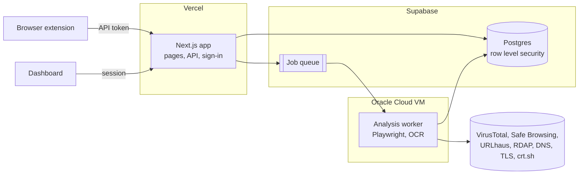

<div align="center">

# TrustGuard

**Investigate a suspicious link like an analyst would, in one click.**

TrustGuard pulls evidence from URL structure, domain registration, DNS, TLS certificates, redirect chains, page behavior, screenshots and reputation feeds, correlates it, and returns a 0-100 risk score with a separate confidence score and a plain explanation of why. A browser extension uses the same engine to warn people before they open, click or paste a risky link.

[](https://github.com/Yash150406/TrustGuard/actions/workflows/ci.yml)
[](LICENSE)
[](https://usetrustguard.vercel.app)

[Live app](https://usetrustguard.vercel.app) · [Architecture](docs/architecture.md) · [Design spec](docs/specs/2026-10-11-trustguard-design.md) · [Security policy](SECURITY.md)

</div>

---

## Status

**Phase 1 of 11 is complete and deployed.** The foundation is live: sign-in, organizations, roles, invites, API tokens and the full database, all running on free tiers. Scanning arrives in phase 2. The [roadmap](#roadmap) shows what lands when.

## Why TrustGuard

Most URL checkers give you a verdict and nothing else. When a link looks off, an analyst wants to know *why*: how old the domain is, where it redirects, what the certificate says, whether the page asks for a password and where that password goes. TrustGuard does that legwork, then shows its reasoning instead of hiding it.

- **Evidence, not a black box.** Every point in the score links back to the finding that caused it.
- **Risk and confidence are separate.** A clean result from a source that timed out is reported as *unavailable*, never as *safe*.
- **Built for teams.** Organizations, roles and invite links, so a security team can share investigations, watchlists and incidents.
- **Protects people where they click.** The extension checks pages, links on hover and click, copied links and downloads, without ever reading what someone types into a form.

## Risk levels

| Score | Level | Meaning |
|---|---|---|
| 0-39 | **SAFE** | No significant risk signals found. Not a guarantee. |
| 40-69 | **SUSPICIOUS** | At least one meaningful indicator. Be careful. |
| 70-100 | **HIGH RISK** | Strong evidence. Avoid interacting. |

## Architecture

Where the system is heading. The web app, database and sign-in are live today; the worker and job queue arrive in phase 2.



The worker only makes outbound connections, so untrusted pages are opened on a machine that holds no user data and exposes no ports. Scoring will live in `packages/core`, a pure package with no network calls and no clock reads, so the same evidence always produces the same score.

## Built so far

- **Accounts:** sign in with GitHub or Google, and connect both to the same account from Settings
- **Organizations:** personal org on first sign-in, single-use invite links, four roles (viewer, analyst, admin, owner), org switching
- **API tokens:** for the extension, stored only as hashes, revocable, and unable to manage the account even if stolen
- **Data layer:** full schema for every phase, row level security on all tables, org isolation enforced in one data-access layer
- **Platform:** rate limiting, a shared cache for public intel lookups, security headers, error responses that never leak internals
- **Delivery:** CI with lint, typecheck, tests, build and a secret scan on every push; production deploys on merge to `main`

## Security

A security tool has to hold itself to a higher bar. Some of what's in place today:

- Row level security on every table, with a test that fails if a new table ships without it
- Account actions (tokens, invites, members) accept a signed-in session only, never an API token
- Settings forms are pinned to the org they were rendered for, so a stale tab can't act on another org
- An org can never lose its last owner, and a user can never disconnect their last way to sign in
- Same-site-only redirects after sign-in, a Content-Security-Policy, HSTS and frame blocking (nonce-based CSP is planned for phase 10)
- Server logs record full errors with every secret and the database password blanked out

Found something? Please report it privately: see [SECURITY.md](SECURITY.md).

## Roadmap

| Phase | Scope | Status |
|---|---|---|
| 1 | Foundation: monorepo, schema, auth, orgs, settings, CI, deploy | ✅ Done |
| 2 | URL scanner, VirusTotal, Safe Browsing, URLhaus, domain age, scoring engine, worker | Next |
| 3 | DNS, TLS, certificate history and redirect chains, with SSRF protection | Planned |
| 4 | Page behavior, phishing language, screenshots and OCR in a sandbox | Planned |
| 5 | URL DNA, evidence correlation, confidence and plain-language explanations | Planned |
| 6 | Interactive threat infrastructure graph and phishing campaign matching | Planned |
| 7 | Browser extension: page, click, hover, copy, form and download protection | Planned |
| 8 | Monitoring, history, security diffs, incidents and the org dashboard | Planned |
| 9 | Tamper-evident investigation artifacts with SHA-256 verification | Planned |
| 10 | PDF reports, hardening and launch | Planned |
| 11 | Investigation assistant: ask questions, get answers grounded in the evidence | Planned |

## Stack

| Part | Tech |
|---|---|
| Web app and API | Next.js 16, React 19, TypeScript, Tailwind CSS 4, Auth.js |
| Data | PostgreSQL on Supabase, Drizzle ORM, pg-boss |
| Analysis worker | Node.js, Playwright, Tesseract, Docker on an Oracle Cloud ARM VM |
| Extension | Chromium Manifest V3, published on Edge Add-ons |
| Testing | Vitest against an in-memory Postgres (PGlite) with the real migrations |
| Delivery | GitHub Actions, gitleaks, Vercel |

Everything runs on free tiers. The whole project is built to cost nothing to run.

## Run it locally

You need Node 24 and pnpm 11.

```bash
pnpm install
cp .env.example apps/web/.env.local   # then fill it in, see docs/environment.md
pnpm --filter web dev                  # http://localhost:3000
```

```bash
pnpm test        # all packages
pnpm typecheck
pnpm lint
```

[docs/environment.md](docs/environment.md) walks through the free Supabase project and the GitHub and Google sign-in apps. [docs/deployment.md](docs/deployment.md) covers Vercel and migrations.

## Repository layout

```
apps/web          Next.js app: pages, API routes, server actions, sign-in
apps/worker       analysis worker (phase 2)
apps/extension    browser extension (phase 7)
packages/core     pure logic: URL normalization, shared types, schemas, roles, scoring
packages/db       Drizzle schema, migrations and every database query
docs/             spec, plans, architecture, design, decisions
```

## Scope

TrustGuard is not a replacement for VirusTotal, an EDR, a SIEM or a browser sandbox. What it adds is the layer on top: combining different kinds of evidence, mapping how infrastructure connects, explaining the score, and tracking changes over time.

## Maintainers

- **Aniruddha More** ([@Aniruddha072](https://github.com/Aniruddha072))
- **Yash More** ([@Yash150406](https://github.com/Yash150406))

## License

[MIT](LICENSE)
